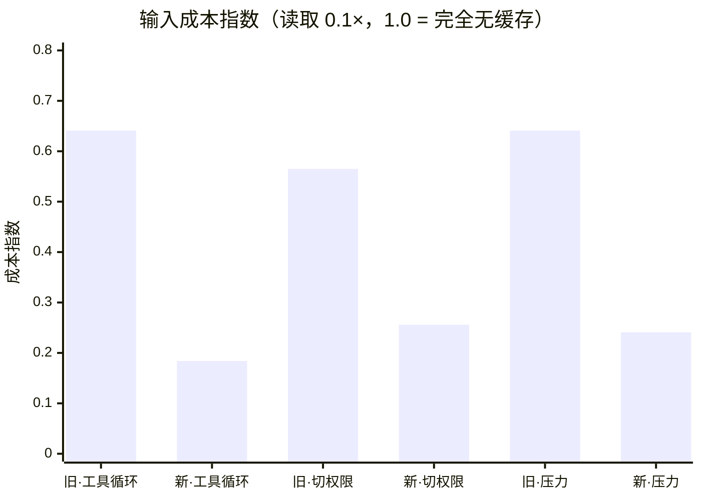
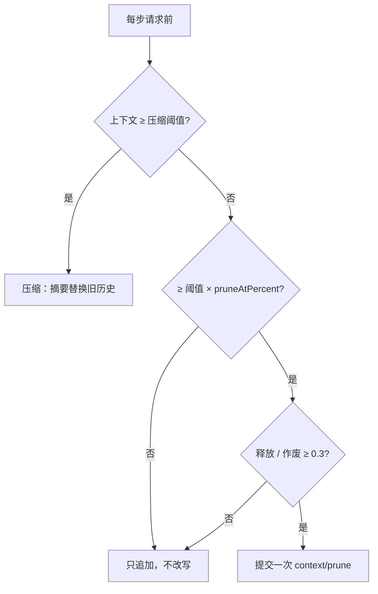

# 让前缀可缓存：一次 SMART 拆解

> 2026-10-26 · ruobai-harness
>
> KV cache 不是一个可以"打开"的开关，它是 prompt 装配结构的结果。这篇用 SMART（Specific / Measurable / Achievable / Relevant / Time-bound）拆一次：问题具体是什么、怎么量、为什么不动推理引擎、什么时候该停。

## S｜问题：每一步都换了一份 prompt

提供方按**前缀**缓存：请求按 `tools → system → messages` 渲染，某个位置之前有任何一个字节不同，它之后全部失效。所以命中率不取决于加了多少标记，而取决于**有没有改写自己已经发出去的历史**。

改造前有五处会改写历史，最严重的是工具结果裁剪：每来一条新的大结果，就有一条更早的结果从完整变成摘要，前缀从那里断开。用仓库代码实测：一条结果从 9,002 字符变成 5,020，**释放 3,980 字符，作废 72,016 字符的后缀**。

目标因此不能写成"提升命中率"，而要写成：

> 让上一份请求的渲染结果成为下一份请求的严格前缀；所有必须改写历史的地方，变成一次显式的、能解释代价的 epoch。

## M｜先定义口径，再谈收益

三个口径：**命中量**（相邻请求的最长公共前缀）、**重新处理量**（按原价计费的部分）、**成本指数**（`(命中 × 读取倍率 + 重新处理) / prompt 总量`，`1.0` = 完全无缓存）。

实验用同一套渲染路径做 A/B：新策略调用真实的 `build()`；旧策略每步提交一个等价 epoch 复现改造前的行为。20 步、每步约 10k 字符工具结果，关闭摘要。

| 场景 | 策略 | 重新处理字符 | 断点 | 成本@读取0.1× | 成本@读取0.5× |
| --- | --- | ---: | ---: | ---: | ---: |
| 工具循环 | 旧 | 1,320,993 | 12 | 0.641 | 0.801 |
| | 新 | 255,145 | 0 | **0.184** | **0.547** |
| 中途切权限 | 旧 | 369,840 | 3 | 0.565 | 0.758 |
| | 新 | 128,985 | 0 | **0.256** | **0.587** |
| 压力下裁剪一次 | 旧 | 1,320,993 | 12 | 0.641 | 0.801 |
| | 新 | 388,364 | 1 | **0.241** | **0.578** |



稳态最能说明问题：旧策略每步重算约 103k 字符、命中 40.5%；新策略约 12.6k、命中 95.1%。新策略发送的 prompt 反而更大（不再裁剪旧结果），但多出的部分按读取价计费，**总成本仍低七成**——"省 token"和"省钱"不是一回事。

字符级前缀是上界：提供方按 token 块向下取整，绝对命中率会略低；新旧差距仍在 3 倍以上。

## A｜不动推理引擎，靠结构

推理引擎确实握有 harness 看不到的运行时信息，但这里不改它：仓库默认接的是云 API，不是自托管；需要的观测（单请求命中量、队列与 KV 压力）已经在 usage 和 `/metrics` 里；需要改引擎的只剩"控制"，而单用户、串行会话没有对应的压力场景。

收益来自两处结构改动：

**一、裁剪改成单调的 prune epoch。** 新增 `context/prune` 事件，一旦提交，`seq <= upToSeq` 的结果按同一份文本裁剪，**之后不再回看**。同一份日志永远得到同一份投影。

真正的设计点不是怎么裁，而是**什么时候值得裁**。设作废后缀为 `S`、释放量为 `F`、后续步数为 `K`：

```
一次成本 ≈ S × (rw − rd)
收益     ≈ K × F × rd
值得做   ⟺  F / S > (rw − rd) / (K × rd)
```

按读取 0.1×、写入 1.25× 算，5 步回本需要 `F/S > 2.3`；实测只有 `0.055`，要 209 步。所以默认**不单独裁剪**：压力大就直接压缩，压缩本来就要重写历史。



**二、工具数组做成不变量。** 工具定义渲染在最前面，改一个就整段作废。改造前它同时受模式和权限过滤；权限属于安全策略，而安全策略不该靠"模型看不见"来实现——`invoke` 本来就会拒绝越权调用。于是权限不再过滤工具数组，只在执行边界拒绝。代价是 `read-only` 下模型可能白试一次写工具。

同样重要的是几个"不做"：不预热；不把摘要搬出 system（压缩时 messages 本来就会失效，挪了不省）；不做驻留查询、缓存压力与按引擎信号调度（没有公开接口，做了只是猜）。

## R｜为什么值得做

因为 agent 会话的成本结构就是"每一步重发全部历史"。40k 上下文里 39k 按读取价还是原价，差的是每一步。

它同样影响质量：旧策略为了省 4k 字符去改写旧结果，模型看到的是被截断的历史；新策略保留原文，把压力交给有质量把关的压缩。缓存收益不只是钱，还包括**不用为了省钱牺牲上下文**。

最后是解释性。`context/cache-break` 记录每次断在哪里、为什么、作废多少——没有这行字，缓存回归会静默存在几个月：请求都成功，只是账单更贵。

边界也要说清：一次性问答、短会话、每次 prompt 都从头不同的场景，这套东西没有收益。

## T｜什么时候停

落地顺序按"先观测、后改结构"：前缀指纹 → 工具与裁剪 → 缓存意图与测试。旧日志没有 `context/prune` 时投影退化为不裁剪，这是安全的默认。

停止条件提前写死：

- **引擎侧**：主部署切到自托管、出现多会话相互驱逐、结构问题修完仍不达标，三条同时成立才考虑；顺序是 `/metrics` → 调度类 → 最后才谈插件。
- **TTL**：长档写入更贵，至少 3 次读取才回本；只有回合间隔 p90 超过 5 分钟才切。
- **优化本身**：命中率进入 90% 以上、剩余损失都能归因为压缩或换模式这类必要改写时，就停。

## 收束

这次没有加一行 `cache_control`，也没有碰推理引擎。做的是一句话：

**把历史当接口。只追加，不改写；任何必须改写的地方，做成一次显式、可计价、可解释的 epoch。**

前缀缓存只是这条约束最诚实的审计员——它不关心架构图，只关心上一份请求的字节是不是下一份请求的开头。

## 术语表

| 术语 | 解释 |
| --- | --- |
| KV cache / 前缀缓存 | 提供方把已处理过的前缀的注意力状态留在显存里；下一次请求只需计算相同前缀之后的字节。 |
| 前缀（prefix） | 按 `tools → system → messages` 渲染后，某个位置之前的全部字节。 |
| 命中 / 未命中 | 命中部分按读取价计费；未命中部分按原价处理。 |
| 读取价 / 写入价 | 相对原价的倍率：读取常见 0.1×，写入 1.25×（长 TTL 档可达 2–2.5×）。 |
| cache_control / 缓存断点 | Anthropic 的显式标记，指定在哪一段末尾建立缓存点；OpenAI 与 DeepSeek 自动按前缀缓存，无需标记。 |
| token 块 | 提供方按固定粒度（64 / 128 / 1024 token）向下取整后缓存，所以字符级命中率是上界。 |
| epoch | 本文指一次显式的历史改写边界：边界内投影不变，边界处一次性提交并重新预热缓存。 |
| 前缀指纹 | 对 tools、system、每条消息求哈希，用来定位"前缀从哪一段开始变了"。 |
| prune（裁剪） | 把旧的超大工具结果保留头尾、略去中段；只影响模型视图，不修改日志。 |
| compaction（压缩） | 用模型把较早的历史总结成检查点，替换模型可见的历史。 |
| TTL | 缓存条目的存活时间；Anthropic 默认 5 分钟，另有 1 小时档。 |
| p90 | 90 分位数；这里用来判断"回合间隔通常有多长"。 |
| 单调（投影） | 同一份日志永远得到同一份结果；追加事件不会改变已经产出过的部分。 |
