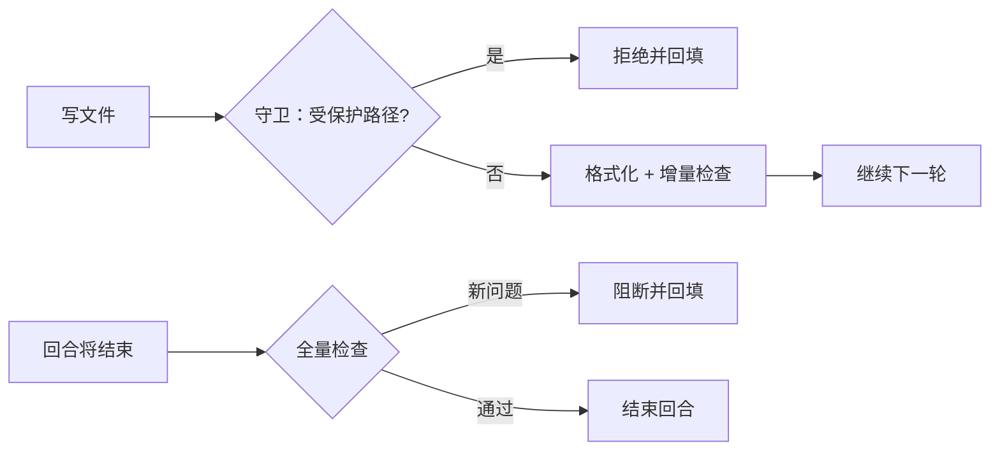

# 门禁要能验收

> 2026-10-27 · ruobai-harness
>
> 给 agent 加门禁容易，证明它真的在拦很难。这篇用注入缺陷的方式实测：编辑层 155ms、Stop 层约 5 秒、四类越权全部拦住、旧债不阻塞新债，以及一次"看起来在跑、其实没跑"的翻车。

## 主张先写出来

门禁的价值不是"我加了检查"，而是"我能给你一份可复现的验收报告"。四个问题：

1. **代价**：一次检查多久，能不能放在每一步；
2. **检出**：注入的缺陷抓不抓得住，报不报得到行；
3. **增量**：旧债会不会把新债淹掉；
4. **反馈**：报错能不能直接照着改，全绿时是否安静。

再加上一条元要求：**门禁自己出错时必须可见**。一个沉默的假门禁，比没有门禁更危险。

## 怎么测的

先把三条边界说清楚，免得读者高估这些数字：

- 用的是仓库自己的 Biome 2.6.3 与 `tsc`，通过运行中的应用 HTTP API（`POST /api/hooks/run`）调用——走的就是 agent 用的那条 `ctx.shell` → 解析 → 分区链路，不是另写的脚本。
- 方法是**注入**：先测干净状态，再往 `packages/lint/tests/__probe.ts` 注入一个 lint 错误和一个类型错误，跑完删除。它只能证明"这一类缺陷抓得住"，不等于线上漏报率。
- 单仓库、单次运行；绝对耗时受机器负载影响，比例关系比绝对值更可靠。

三个门的位置大致是这样（细节见 `docs/hooks.md`）：



## 一、代价：编辑层可以每步跑，Stop 层不行

| 场景 | 总耗时 | 分解 | 结果 |
| --- | ---: | --- | --- |
| 编辑层 · 干净 | 155ms | format 78 + lint 77 | 0 条 |
| 编辑层 · 注入 lint 错误 | 236ms | 同左 | 1 条 error，行号 2 |
| Stop · 干净 | 4,998ms | biome 93（并行）+ typecheck 4,998 | 6 条 warning |
| Stop · 注入类型错误 | 2,222ms | typecheck 2,221 | 1 条 TS error + 6 条旧 warning |

判断：

- 编辑层是百毫秒级，**可以每次写入都跑**；Stop 层五秒级，只在一轮结束时跑一次合理，挂在每个工具调用后面会毁掉交互。
- Stop 的九成成本在 `tsc`，Biome 只占 0.1 秒。**"Stop 慢"不是门禁慢，是类型检查慢**；想优化，方向是增量编译或只检查改动包，而不是砍规则。
- 启动方式也值一个数量级：同样一条 Biome 检查，`pnpm exec` 是 785ms，换成 `node_modules/.bin/biome` 是 155ms。多一层包管理器，就多一次冷启动。

## 二、检出：注入的缺陷抓得住吗

- **lint**：注入 `debugger`，236ms 内命中 `lint/suspicious/noDebugger`，报在 `__probe.ts:2`。
- **类型**：注入 `const text: number = 'nope'`，Stop 层 2.2 秒命中 `TS2322`，同样带行号。
- **行为守卫**：写了 7 个用例，4 拒 3 放行。

| 操作 | 结果 | 原因 |
| --- | --- | --- |
| 写 `.claude/settings.json` | 拒绝 | 受保护路径 |
| 写 `biome.json` | 拒绝 | 受保护路径 |
| 写业务源码 | 放行 | 正常改动 |
| `git commit --no-verify` | 拒绝 | 绕过门禁 |
| `cat tsconfig.json` | 放行 | 只读，不拦 |
| `echo … > .claude/settings.json` | 拒绝 | 重定向写保护路径 |
| `git status` | 放行 | 正常命令 |

守卫的边界值得单独说：**读配置放行、写配置拒绝**，否则 agent 连诊断自己都做不到；命令层面只拦"写"，不是见到 `tsconfig.json` 就拒绝。

## 三、增量：旧债不该把新债淹掉

这是门禁能不能活过第一周的关键。仓库里有 6 条存量 warning（都来自新包的风格建议），三种状态：

| 状态 | fresh | known | 阻断 |
| --- | ---: | ---: | ---: |
| 没有基线 | 6 | 0 | 0（warning 不阻断） |
| 写入基线后 | 0 | 6 | 0 |
| 再注入一个类型错误 | 1 | 6 | **1** |

判断：没有基线时，每次 Stop 都在"发现问题"，很快所有人都会学会忽略它；有了基线，注意力只留给那 1 条新增错误。增量门禁不是宽容，是**把信号从噪音里捞出来**。

代价也要认：基线文件本身是债务账本，需要有人定期还——否则它只是把问题藏起来。

## 四、反馈：一条错误 57 个 token

注入类型错误后，回填给模型的内容是：

```
<hook-diagnostics layer="stop" round="1" new="1" shown="1">
packages/lint/tests/__probe.ts:2 [TS2322] Type 'string' is not assignable to type 'number'.
</hook-diagnostics>
```

171 个字符，按仓库估算约 57 token。带路径、行号、规则名和原因；全绿时不发任何消息。

判断：反馈的成本必须低于它省下的排查时间。让模型重新读一遍文件、自己找哪里错了，远比 57 个 token 贵。另一条同样重要——**只回填新问题**，否则每一轮都在重复上一轮已经看过的旧账。

## 五、一次翻车：检查器看起来在跑

第一次测 Stop 层时，注入类型错误后返回的诊断里**没有 TS 错误**，`typecheck` 退出码 2，还附带一条 Seatbelt 拒绝。

两个原因叠在一起：

1. `tsc` 把诊断写到 **stdout**，而解析器先读 stderr——stderr 里是 pnpm 的启动 banner，于是读到了一行命令，却没读到错误；
2. `pnpm typecheck` 在失败路径上触发了沙箱拒绝（pnpm 要写自己的日志），把退出码和输出搅得更乱。

修复是两行：tsc 解析同时读 stdout 和 stderr；检查命令改用 `node_modules/.bin` 直跑。

这次翻车比测出来的数字更有价值：**它是被运行记录里的 `checker error` 暴露的**。如果当时的设计是"没有诊断就算通过"，这个门禁会一直显示绿色，而它一个类型错误都没检查过。所以"检查器不可用要可见"不是可选项——本地没装工具链时，门禁应该是"哑"的并留下记录，而不是安静地点头。

## 六、熔断：别让门禁自己变成死循环

Stop 层允许阻断，但有上限：连续两轮未通过，或诊断指纹集合与上一轮完全相同，就升级（`hooks/escalated`）并放行结束，不再阻断。

判断：门禁的目标是让人或 agent 改对，不是把它困在原地。这条由单测覆盖——同一组诊断第二次出现时必然升级，不会无限循环烧 token。

## 七、边界

- **范围是分阶段的**：Biome 目前只覆盖三个新包。全仓 `recommended` 会带出两万多条存量问题（含构建产物），一次开全，CI 第一天就红。
- **基础设施失败默认放行**：二进制缺失、超时，记录但不阻断；只有把该层 `failure` 设为 `close` 才进入阻断路径。
- **L2 只报告**：语义审计按日预算跑，结果进 `hooks/audit`，永不阻断；它不是确定性门禁。
- **分支保护是仓库外配置**：CI 能跑、能红，是否要求合并前通过，需要在 GitHub 仓库设置里开。

## 收束

门禁的验收标准不是"我加了检查"，而是**我能说清它拦住了什么、放过了什么、为什么**。

数字会变，机器会换，规则会加；能留下来的是这套可复现的验收方式——注入一个缺陷，看它是否在预期的时间、预期的那一行、以预期的方式被抓住。

## 术语表

| 术语 | 解释 |
| --- | --- |
| Hook | 绑定在生命周期节点上的确定性动作；本文指 `PreToolUse`（执行前）、`PostToolUse`（写入后）与 `Stop`（回合结束前）。 |
| Linter | 只报告、不改文件的检查器；本文用 Biome 与 tsc。 |
| Stop 闸门 | 模型不再调用工具、准备结束回合时执行的检查；未通过则回填并继续。 |
| 基线 | 已知问题的指纹清单；在基线里的问题不算新增。 |
| 增量门禁 | 只对新增或恶化的问题失败，历史债务不阻塞。 |
| fail-open / fail-close | 失败时放行 / 失败时阻断。基础设施故障默认 fail-open，安全守卫与严格 Stop 用 fail-close。 |
| 熔断 | 连续多轮无法通过时停止阻断并升级，避免死循环。 |
| 诊断指纹 | 由规则、路径、归一化消息算出的稳定哈希，用来区分"同一个问题"和"新问题"。 |
| L2 审计 | 用模型做语义检查（设计一致性、安全、测试质量），只报告不阻断。 |
| Seatbelt | macOS 的沙箱机制；本文的检查命令也跑在它下面。 |
