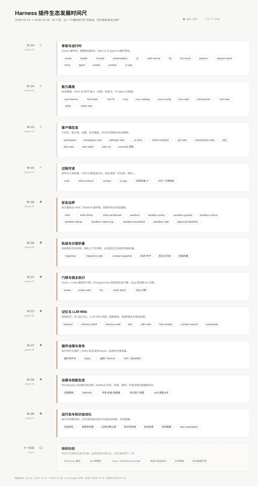

# Harness 插件生态发展时间尺

> 数据来源：`git log`（2026-10-24 → 2026-10-31）与 `packages/` 清单（105 个包）。图是 SVG，源文件在 `assets/plugin-ecosystem-timeline.svg`，文件面板会直接渲染。
>
> 同期的开发约束见仓库根目录的 [AGENTS.md](../AGENTS.md)。

## 怎么读这张图

- 纵向是时间，每个阶段一张卡片；左侧是日期与阶段编号，右侧是这一阶段新增的插件/能力。
- 卡片里的 chip 是**插件包名或能力名**，不是一次提交；一个阶段内可以有多次提交。
- 底部红色虚线卡片是**已设计但尚未落地**的下一步，不属于已完成的时间线。
- 10-26 之后用强调色标出：项目从"能跑"转向"边界可解释、过程可读、知识可治理"。

## 阶段说明

| 阶段 | 日期 | 主题 | 代表插件 / 能力 | 为什么重要 |
|---|---|---|---|---|
| 01 | 10-24 | 骨架与运行时 | `cordis`、`loader`、`cli`、`web-server`、`session`、`tools`、`agent`、`context`、`ui-app` | 应用变成一棵插件树：`cordis.yml` 是唯一定义，之后每个能力都可替换 |
| 02 | 10-24 | 能力基座 | `tool-bash`、`tool-fs`、`mcp*`、`permissions`、`checkpoints`、`tool-task`、`skills` | agent 开始真正操作工作区：命令、文件、外部工具与回退 |
| 03 | 10-25 | 客户端生态 | `workspace*`、`ui-slots`、`client-modules`、`settings-web`、`git-web`、`a2a*` | UI 从单一聊天页变成可组合的客户端插件；设置、Git、协议接入就位 |
| 04 | 10-25 | 过程可读 | `chat`、`chat-protocol`、`context`、`ui-app` | 思考/工具先折叠再展示；耗时与计费落进日志，刷新不丢 |
| 05 | 10-26 | 安全边界 | `shell*`、`sandbox*`、`approval-deadline` | shell 与沙箱拆成插件；拒绝→分类→升级→重跑闭环；状态面板可见 |
| 06 | 10-26 | 轨迹与分层折叠 | `trajectory`、`trajectory-web`、`context snapshot` | 轨迹从"浏览器 fold 日志"变成 Host 投影 + 增量帧；回合按正文分层折叠 |
| 07 | 10-27 | 门禁与宿主执行 | `hooks`、`hooks-web`、`lint`、`shell-direct` | 提交前检查变成确定性门禁；harness 自己的 lint/typecheck 走宿主执行器，不受 agent 沙箱影响 |
| 08 | 10-27 | 记忆与 LLM Wiki | `memory*`、`wiki*`、`context-search`、`commands` | 两层知识：小记忆常驻注入，大 wiki 按需检索；提案审核、来源、版本与混合检索就位 |
| 09 | 10-27 | 插件治理与发布 | 插件热开关、`Gitee`、品牌与开源准备 | 插件可运行时启停；仓库浏览、发布、Issue/PR 接入 |
| 10 | 10-28 | 设置与技能生态 | 设置重构、`SkillHub`、专家·技能·连接器、知识库三视图 | 设置从表单改成分组卡片；技能从本地目录扩展到可浏览、安装、移除的市场 |
| 11 | 10-28 | 运行态与知识自动化 | 消息排队、权限热切换、应用内确认框、知识库目录、自动检索、空闲提案、`wiki-automation` | 会话运行中可改权限/排队消息；目录可分组，知识检索与提案生成变成可选开关 |
| 12 | 10-29 | 回合内交互 | `ask`/`ask-web`、前置检查、计划审批卡片、提交卡片、逐页向导 | 提问在回合内阻塞等待回答；计划与提交变成卡片，确认不再靠对话往返 |
| 13 | 10-29 | 会话与面板 | 会话草稿、工作区折叠（5 条渐进展开）、会话栏独立、`terminal` 右侧面板、圆角卡片 | 没发消息的会话不再落盘；折叠状态可记住；右栏四个视图统一成圆角卡片，不再各自印标题 |
| 14 | 10-29 | 预览与推送 | `browser-preview`（共享页面/快照/点击/输入）、screencast 投屏、更改面板提交栏、可插拔 Git 托管、终端底色 | 验证闭环变成「打开→交互→看结果」，模型在操作的那一页用户也能看到；提交与推送回到更改面板，托管平台按插件注册 |
| 15 | 10-30 | 交付契约与证据 | `contract`、`visibility` 分层、证据门禁、验收绑定 `todo`、`delivery`、`handoff`、`client-audit` | 验收条款进系统提示并跨压缩保留；验收缺口阻断回合并按指纹熔断；交接包与客户只读审计视图就位 |
| 16 | 10-30 | 交付面板与质量门 | `delivery-web`、`provider-catalog`、环境档案 CRUD、`skill-distiller`、`rubric`、`eval`（各含 web 半边） | 交付状态进右侧信息栏；技能草稿需批准才进技能根；诊断与评测先对比基线，再产出提案或拒绝 |
| 17 | 10-30 | 桌面壳与模型厂商 | `apps/desktop`（Electron）、三平台打包流水线、`llm-openai`、`llm-balance`、工具目录 `defer` | 界面复用现有前端、状态仍由本机 harness 管；厂商按 provider 注册，余额与今日用量可见 |
| 18 | 10-31 | 设计系统与网络边界 | 设计系统与皮肤、`net`、`sandbox-proxy`、边界即授权 | 颜色与组件收敛到 token；网络出口只有本机代理；沙箱与审批通过「边界即授权」衔接，不再做路径级升级 |
| next | — | 继续向前 | `jail` 部署层、`Linux/Windows provider`、轨迹行级虚拟化、时间概览、交付证据评测 | 设计已定、尚未落地 |

## 三个观察

1. **插件数量在八天内从 0 到 105，但分组方式一直没变**：数据/能力、Web 适配、客户端半边、执行边界。新增能力基本只是往这四类里加包。
2. **越晚的阶段越"可治理"**：前两阶段解决"能不能做"，中间解决"过程能不能解释"，后段解决"知识怎么沉淀、交付怎么验收、自动操作怎么设边界"。沙箱面板、轨迹、知识库审核、交付证据门禁都属于后一类——它们不是新能力，而是让已有能力可被信任。
3. **10-30 之后重心从"界面上的能力"转向"对外的承诺"**：契约、证据门禁、交接包、客户审计把「做完了」变成可检查的状态；桌面壳与代理则是同一个方向的另一种形态——把边界从进程内推到整个应用。

## 维护

时间尺按阶段而非提交更新。新增一个阶段时：

1. 在 `scripts/gen-plugin-timeline.mjs` 的 `PHASES` 里追加一项（日期、标题、说明、chip、是否强调色），运行 `node scripts/gen-plugin-timeline.mjs` 重新生成；
2. 用 `node scripts/check-plugin-timeline.mjs` 校验排版（chip 不越界、日期递增、画布覆盖页脚），它会在越界时报出具体坐标；
3. 同步上面的阶段表与包数量、日期范围。

需要重新排版时，chip 宽度按字符宽度估算、每行 `CARD_W - 40` 换行即可，SVG 不依赖外部字体。
